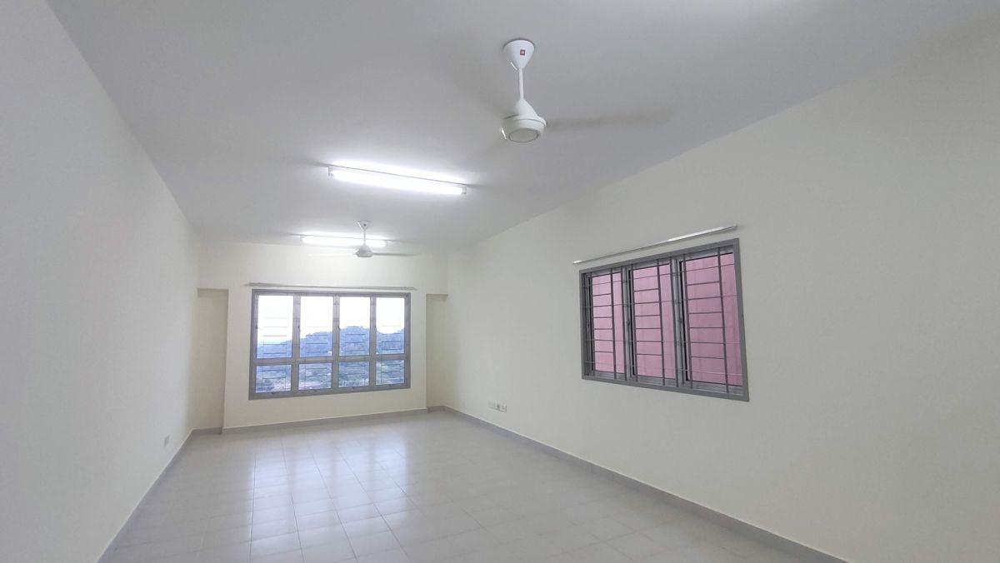
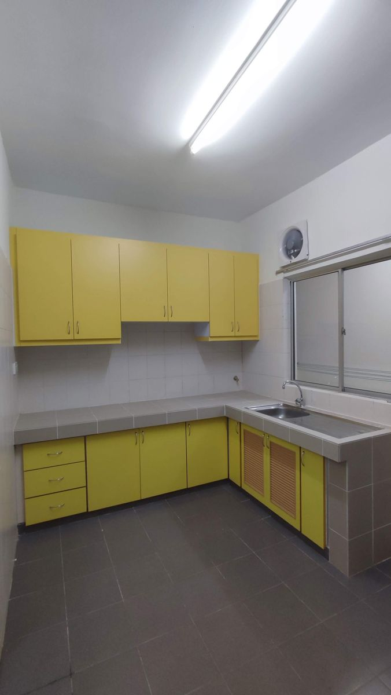
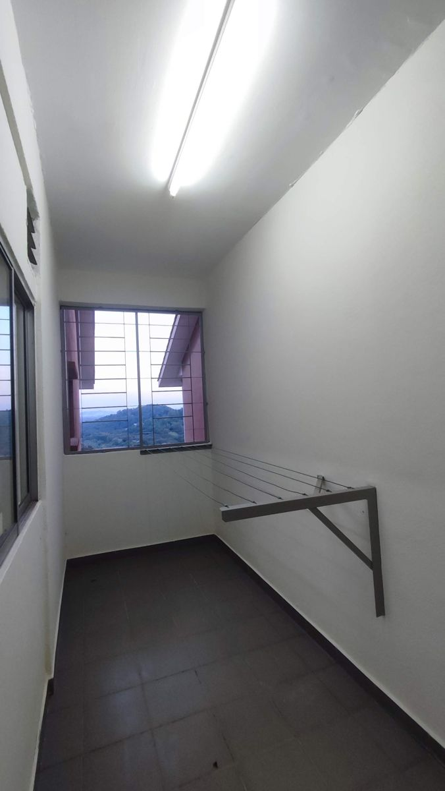
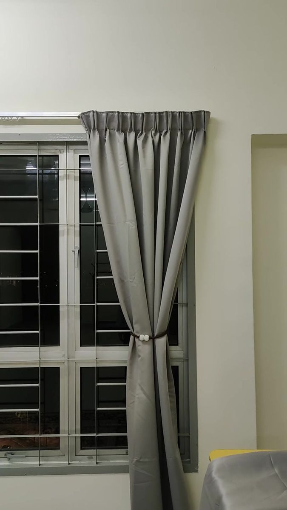
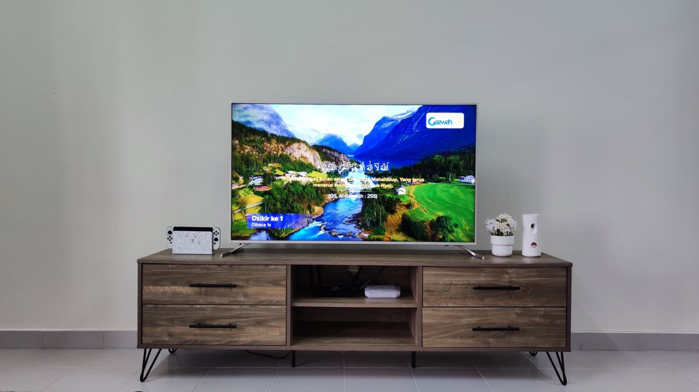
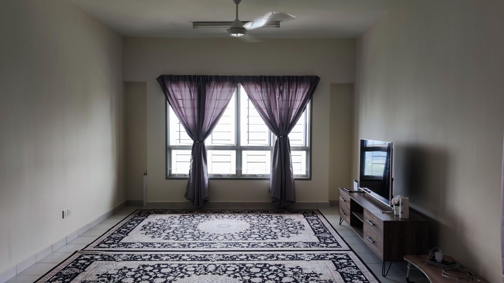

<!--
CADANGAN TAJUK (pilih satu; 70 aksara atau kurang):
1. Masuk rumah sewa kosong: apa nak beli dulu kalau bajet terhad?
2. Rumah kosong, bajet terhad: barang apa nak beli dulu?
3. Barang keperluan rumah baru: apa saya beli dulu dan berapa habis?

Meta description (≤155 aksara): Masuk rumah sewa kosong dengan bajet terhad? Ini susunan barang yang saya beli dulu, apa boleh tunggu dan berapa habis, termasuk tips beli di Carousell.
Slug URL: rumah-sewa-kosong-apa-nak-beli-dulu
Kategori: Rumah
Anggaran masa baca: 7 minit
Kata kunci utama: barang keperluan rumah baru
Kata kunci sampingan: masuk rumah sewa kosong, barang wajib beli rumah baru, kos isi rumah kosong, beli barang secondhand Carousell
Gambar: 6 gambar sendiri (11 Ogos hingga 13 Okt 2023), saiz dikecilkan dan data lokasi dibuang
Permintaan privasi Ibrahim: tidak sebut nombor blok atau unit; "barang tambahan" sahaja untuk perbelanjaan selepas itu
-->

# Masuk rumah sewa kosong: apa nak beli dulu kalau bajet terhad?

11 Ogos 2023, saya akhirnya pegang kunci rumah. Bila buka pintu, isinya cuma kipas, lampu, penyidai baju, kabinet dapur dan almari dinding. Yang lain? Kosong sekosong-kosongnya.

> **Jawapan ringkas:** Kalau bajet terhad, ikut susunan ni: barang cuci rumah, langsir, toto atau tilam, karpet dan barang dapur asas. Peti ais boleh menyusul bila ada duit lebih. Sofa dan mesin basuh boleh tunggu. Saya sendiri habis lebih RM5,000 untuk barang keperluan rumah baru masa mula-mula masuk.

<figure>
  
  <figcaption>Hari pertama dapat kunci, 11 Ogos 2023. Kosong, cuma ada kipas dan lampu.</figcaption>
</figure>

Mesti ramai pening bila berdepan situasi macam ni, kan? Kalau duit berkepuk, borong je semua. Tapi kalau bajet suam-suam kuku, nak mula dari mana?

Ini cerita sebenar saya: apa yang patut dibeli dulu, apa yang boleh tunggu dan berapa yang "terbang" untuk mula-mula masuk rumah.

## Rumah ni macam rumah sewa, nanti kena pulang

Saya dapat kuarter kerajaan di apartmen Presint 5, Putrajaya, lepas tunggu hampir dua tahun setengah. Statusnya sama macam rumah sewa. Bila tiba masanya, kena pulangkan balik.

Masa tu saya bujang lagi. Sebelum ni saya sewa bilik je, jadi "harta" saya cuma meja belajar dengan kerusi.

Ini yang dah sedia ada dalam unit saya:

- Kipas dan lampu
- Penyidai baju
- Kabinet dapur
- Almari dinding dalam bilik

Tapi jangan anggap semua kuarter sama. Unit di apartmen lain mungkin berbeza. Ada yang siap dengan beranda, saya punya tak ada. Jadi tengok dulu apa yang ada sebelum senaraikan apa nak beli.

<figure class="figure-pair">
  
  
  <figcaption>Kabinet dapur dan penyidai baju memang dah sedia ada. Dua benda kurang nak dibeli.</figcaption>
</figure>

## Fasa sebelum masuk: selesaikan asas dulu

**Elektrik dan air.** Untuk kuarter, ni kena settle sebelum dapat kunci. Ada bayaran deposit sekali. Seronoknya, hari pertama masuk, air dah laju dan kipas dah boleh pusing.

**Kalau ada rosak.** Kuarter ada pihak penyelenggaraan. Biasanya mereka baiki dalam masa terdekat.

**Internet.** Saya pasang Unifi, tapi yang ni tak perlu kelam-kabut. Sementara tunggu, internet telefon pun boleh survive.

## Jangan terus pindah! Ambil masa bertindih

Bila dapat kunci, saya tak terus angkut barang masuk. Saya sambung sewa bilik lama sebulan lagi.

Kenapa? Sebulan tu la masa saya cuci rumah betul-betul dan sediakan apa yang perlu, sikit-sikit. Bila betul-betul pindah, tilam dah siap menunggu. Tak adalah semput nak kemas semua dalam sehari.

## Barang keperluan rumah baru: apa nak beli dulu?

Bajet ketat? Tak payah tertekan. Jangan ikut jumlah belanja saya. Ikut susunan keutamaan ni.

### Pusingan 1: Mod "Survival"

**Barang cuci rumah.** Penyapu, mop, sabun lantai dan berus. Tak glamor langsung, tapi inilah benda pertama saya beli. Vacuum? Belum perlu lagi.

**Langsir.** Lepas lantai bersih, baru pasang langsir. Matahari panas dan jiran boleh nampak dari luar. Lelaki bujang pun kena ada langsir, okay.

Saya beli langsir siap di Shopee. Murah dan cepat sampai. Nak cantik boleh tempah, tapi makan masa dan modal. Petua jimat: pasang di ruang utama dan bilik tidur dulu. Bilik yang tak guna, biar kosong.

<figure class="figure-tall">
  
  <figcaption>Tiga hari lepas dapat kunci, langsir dah naik.</figcaption>
</figure>

**Tempat tidur.** Saya order tilam queen Dr. Macio di Shopee sehari sebelum dapat kunci. Harga RM299, sampai 19 Ogos. Sampai sekarang masih sedap baring.

Saya pun ada beli toto Narita saiz king, RM50.85, dua minggu lepas dapat kunci. Hari biasa saya tidur atas tilam. Bila mak ayah singgah, toto tu la jadi tempat tidur.

Jadi kalau bajet betul-betul nipis, mula dengan toto. Bila dah ada tilam nanti, toto tu tak membazir. Simpan untuk tetamu.

**Karpet.** Sofa belum ada, jadi lantailah tempat duduk. Alas dengan karpet, tak adalah sejuk punggung. Modal RM50 di Shopee pun dah dapat saiz besar.

**Barang dapur asas.** Periuk nasi kecil, kuali, dapur gas, tong gas dan cerek air. Saya bukan reti sangat memasak, setakat masak yang simple-simple je. Selalunya makan luar atau beli lauk di kedai dan masak nasi sendiri. Kuali tu serba boleh: goreng telur, goreng ayam dan masak Maggi.

**Barang kecil yang selalu lupa.** Extension wayar, tong sampah, baldi, penyangkut baju, pinggan, cawan dan pita pengukur. Pita pengukur ni saya beli awal sebab nak ukur tingkap untuk langsir dan ruang untuk karpet. Masa mula-mula senaraikan pun saya terlupa, huhu.

### Pusingan 2: Bila ada duit lebih sikit

**Peti ais.** Kalau ada bajet, beli awal. Ambil besar sikit kalau boleh sebab benda ni pakai bertahun-tahun. Saya punya Toshiba 2 pintu inverter 273L, RM1,165, beli baru di Shopee.

**TV, rak TV, meja makan dan rangka katil.** Semua ni saya beli secondhand. Jimat banyak! Caranya saya kongsi di bawah.

### Pusingan 3: Boleh tunggu dulu

**Mesin basuh (RM680).** Saya beli awal, Sharp top load 7.5kg. Tapi bila fikir balik, tak perlu tergesa pun. Putrajaya ni dobi bersepah.

**Sofa (RM799).** Boleh tunggu. Karpet dah cukup untuk permulaan.

**Vacuum, steam iron dan water heater.** Memang berbaloi ada, tapi bukan untuk bulan pertama.

## Simulasi: kalau bajet cuma RM1,000?

Katakan ada RM1,000 ngam-ngam dalam tangan. Fokus pada ni je:

1. Penyapu, mop dan sabun lantai
2. Langsir untuk ruang utama dan bilik tidur
3. Toto atau tilam, dengan bantal
4. Karpet
5. Periuk nasi, kuali, dapur gas, tong gas dan cerek air

Yang lain? Pejam mata dulu. Kumpul duit pelan-pelan.

## Kos sebenar: berapa habis untuk isi rumah kosong?

Untuk lapan barang paling besar je, saya habis RM4,093.

Baru, dari Shopee:

- Peti ais: RM1,165
- Mesin basuh: RM680
- Sofa: RM799
- Tilam queen: RM299

Secondhand, dari Carousell:

- TV: RM700 (penjual minta RM750)
- Meja makan: RM200
- Rak TV: RM150
- Rangka katil: RM100

Itu belum campur toto, langsir, alat cuci, barang dapur dan banyak lagi barang kecil. Bila campur semua, lepas RM5,000. Jangan pandang remeh barang kecil. Nampak sikit, tapi bila kumpul boleh tahan rabak juga poket.

## Rahsia jimat: teknik beli secondhand di Carousell

Ni cara saya cari barang terpakai dengan selamat:

- **Tapis lokasi dalam 10 km.** Saya set dari Putrajaya. Selalunya yang keluar sekitar Cyberjaya, Bangi dan Dengkil. Bila dekat, boleh pergi tengok sendiri kondisi barang. Kurang risiko kena scam.
- **Susun ikut terbaru.** Iklan baru biasanya tanda penjual masih aktif dan memang nak jual.
- **Cuba nego.** Tak rugi tanya. Penjual TV saya minta RM750, saya dapat RM700.
- **Fikir cara angkut.** Barang besar saya guna Lalamove. Yang kecil macam TV, saya tumpang kereta kawan dan ambil sendiri.

TV tu Skyworth 50 inci, Android TV. Penjualnya duduk di Cyberjaya. Mula-mula saya terkejut juga, kenapa murah sangat? Rupanya dia nak pindah dan nak kosongkan rumah cepat. TV tu baru dipakai tak sampai enam bulan. Harga barunya lebih RM1,000. Sampai sekarang saya masih guna, elok lagi.

<figure>
  
  <figcaption>TV dan rak TV ni dua-dua secondhand dari Carousell.</figcaption>
</figure>

## Dua perkara tambahan yang saya belajar

### 1. Barang paling menyesal lambat ada: wagon trolley

Saya dapat ni sebagai hadiah kahwin daripada kawan. Duduk apartmen, setiap kali bawa barang naik memang kena angkut dari parking ke lif, kemudian ke rumah. Dengan wagon ni, sekali jalan je. Kalau saya tahu ia berguna macam ni, dari awal lagi saya dah beli sendiri.

### 2. Rakam video rumah masa kosong

Saya rakam video rumah masa kosong. Niatnya nak buat kenangan dan kongsi dengan keluarga.

Rupanya ada guna lain. Untuk penyewa, [Speedhome](https://speedhome.com/blog/how-should-i-document-my-rental-unit-before-handover-to-protect-a/) sarankan rakam keadaan asal rumah: gambar dekat setiap kerosakan dan bacaan meter elektrik dan air. Senang buat bukti kalau ada isu bila pindah keluar nanti.

Dua lagi petua daripada bacaan saya. Ni saya tak buat masa tu, tapi rasanya berbaloi:

**Uji semua benda sebelum barang masuk.** [Utusan Malaysia](https://www.utusan.com.my/ringgit/2023/04/bahagian-rumah-yang-wajib-diperiksa-dan-kaedahnya/) cadangkan semak bahagian rumah satu per satu masa masih kosong. Senang buat sendiri:

- **Soket:** bawa charger telefon, cucuk di setiap soket dan tengok telefon mengecas atau tidak.
- **Lampu dan kipas:** petik setiap suis, pusing kipas sampai laju maksimum dan dengar ada bunyi pelik atau tidak.
- **Paip dan tandas:** buka paip di dapur dan bilik air, pam tandas dan tengok bawah sinki ada titisan air atau tidak.

Kalau jumpa yang rosak, buat aduan awal. Masa rumah kosong, senang tukang nak masuk baiki.

**Tahu di mana injap air utama dan kotak fius.** [The Rakyat Post](https://www.therakyatpost.com/trpbm/tips/2026/05/08/baru-pindah-rumah-ini-tips-yang-boleh-anda-lakukan-bukan-hias-dulu-tau/) cadangkan cari dua benda ni dan ambil gambar lokasinya.

- **Injap air utama** ialah kepala paip yang tutup air ke seluruh rumah. Kalau paip pecah tengah malam, inilah yang perlu ditutup dulu.
- **Kotak fius** (orang panggil DB box) ialah kotak suis elektrik rumah. Bila elektrik trip, di sinilah kena naikkan suis semula.

Lokasinya berbeza ikut rumah, jadi cari masa rumah masih kosong dan senang nak nampak. Simpan gambarnya dalam telefon.
<figure>
  
  <figcaption>Ruang tamu yang sama, dua bulan kemudian (13 Oktober 2023).</figcaption>
</figure>

## Soalan lazim

**Apa barang paling penting bila masuk rumah sewa kosong?**
Barang cuci rumah, langsir, tempat tidur dan barang dapur asas. Yang lain boleh menyusul ikut bajet.

**Berapa anggaran kos isi rumah kosong?**
Saya habis lebih RM5,000 pada 2023, termasuk peti ais, mesin basuh, sofa dan beberapa barang secondhand. Kalau nak jimat, RM1,000 pun cukup untuk keperluan asas.

**Perlu ke beli mesin basuh terus?**
Tak semestinya. Kalau kawasan tu banyak dobi, mesin basuh boleh tunggu.

**Toto atau tilam dulu?**
Kalau bajet ketat, toto dulu. Bila dah ada tilam, toto tu masih berguna untuk tetamu.

**Selamat ke beli barang secondhand di Carousell?**
Pada pengalaman saya okay, asalkan pilih penjual dekat supaya boleh tengok barang sendiri sebelum bayar. Saya juga susun ikut iklan terbaru supaya jumpa penjual yang masih aktif.

## Rujukan

- [How to Document Your Rental Unit Before Handover in Malaysia (Speedhome)](https://speedhome.com/blog/how-should-i-document-my-rental-unit-before-handover-to-protect-a/)
- [Bahagian rumah yang wajib diperiksa dan kaedahnya (Utusan Malaysia)](https://www.utusan.com.my/ringgit/2023/04/bahagian-rumah-yang-wajib-diperiksa-dan-kaedahnya/)
- [Baru pindah rumah? Ini tips yang boleh anda lakukan (The Rakyat Post)](https://www.therakyatpost.com/trpbm/tips/2026/05/08/baru-pindah-rumah-ini-tips-yang-boleh-anda-lakukan-bukan-hias-dulu-tau/)
